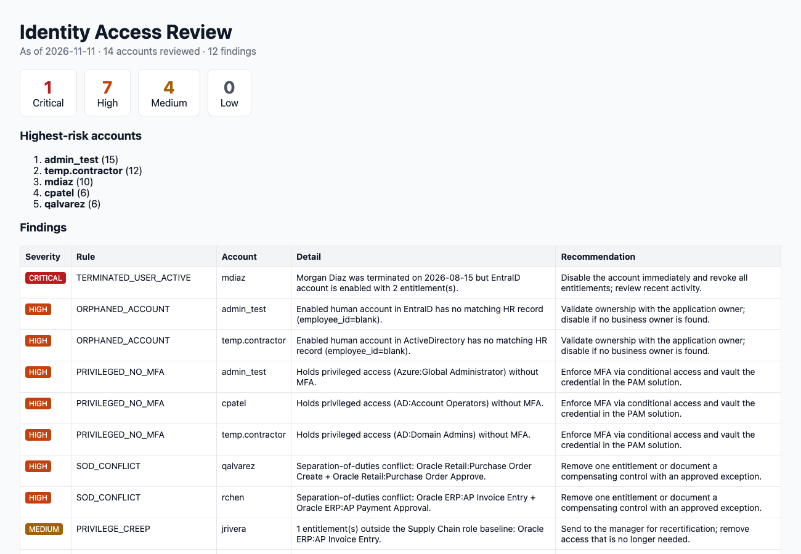

# IAM Access Review Toolkit


An automated **identity access review** (user access recertification) tool. It cross-references an HR roster against identity-provider exports (Active Directory, Microsoft Entra ID / Azure AD, Okta) and application entitlements to surface the identity risks that auditors and IAM teams look for. It flags each issue by severity, gives a recommended fix, and scores risk per account.

It's the kind of check that platforms like SailPoint IdentityIQ automate, written as a small, readable, dependency-free Python tool.



## What It Detects

| Rule | Severity | Why it matters |
|---|---|---|
| `TERMINATED_USER_ACTIVE` | Critical | HR shows the person left, but their account is still enabled (a joiner-mover-leaver gap) |
| `ORPHANED_ACCOUNT` | High | Rogue or orphaned human accounts with no matching HR record |
| `PRIVILEGED_NO_MFA` | High | Domain Admin, Global Admin, PAM vault admin, etc. without multi-factor authentication |
| `SOD_CONFLICT` | High | Separation-of-duties violations (e.g. create **and** approve a purchase order) |
| `STALE_ACCOUNT` | Medium | Enabled accounts dormant past the policy window, or never used |
| `PRIVILEGE_CREEP` | Medium | Entitlements outside the employee's department role baseline (role-based access control) |
| `SERVICE_ACCOUNT_NO_OWNER` | Medium | Non-human accounts with no accountable owner, a PAM onboarding gap |

Each finding includes a remediation recommendation. Accounts get a weighted risk score so reviewers can work the highest-risk identities first.

## Quick Start

Requires Python 3.9+. No third-party packages.

```bash
git clone https://github.com/okrahgadiel-star/iam-access-review.git
cd iam-access-review
python -m access_review --data sample_data --as-of 2026-11-11
```

```
Accounts reviewed : 14
Findings          : 12  critical=1  high=7  medium=4  low=0

Highest-risk accounts:
  admin_test           score 15
  temp.contractor      score 12
  mdiaz                score 10
```

Outputs are written to `output/findings.csv` (for ticketing or GRC import) and `output/report.html` (for reviewers).

### CI/CD Gate

`--fail-on critical|high|never` sets a non-zero exit code when findings at that severity exist. That lets the review run on a schedule in a pipeline and fail the build when a terminated user still has access.

## Input Format

| File | Columns |
|---|---|
| `hr_roster.csv` | employee_id, name, email, department, title, status, termination_date |
| `identities.csv` | account_id, username, email, employee_id, source, account_type, enabled, mfa_enabled, last_login, owner |
| `entitlements.csv` | account_id, application, entitlement |
| `policy.json` | stale_after_days, privileged_entitlements, sod_conflicts, role_baselines, universal_entitlements |

The sample data is fully synthetic.

## Design

```
access_review/
  models.py    dataclasses + CSV/JSON loaders (Employee, Account, Policy)
  rules.py     one pure function per rule -> Finding objects; severity ordering and risk scoring
  report.py    console summary, CSV and self-contained HTML report
  __main__.py  CLI (argparse)
tests/         unit tests per rule + end-to-end test on sample data
```

Each rule is a pure function `Context -> Iterable[Finding]`, so adding a control (e.g. "contractor past end date") is one function plus one test.

```bash
python -m unittest discover -s tests -t . -v
```

## Roadmap

- Pull identities directly from Microsoft Graph (Entra ID) and LDAP instead of CSV exports
- Export findings as ServiceNow incidents
- Peer-group outlier detection for role mining

## License

MIT
